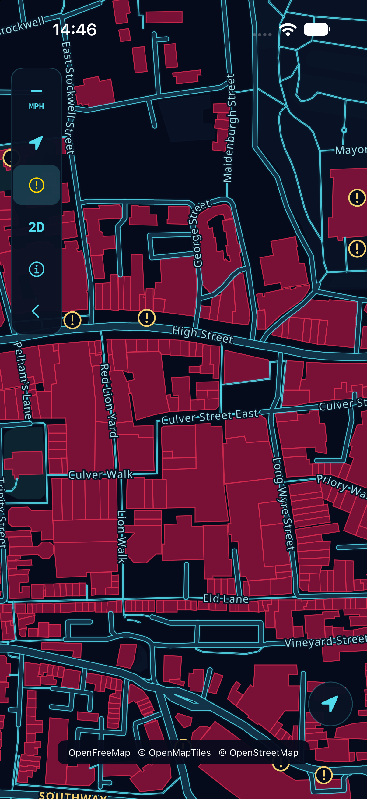

# NightDrive

A personal native SwiftUI map for **iOS 26+**, inspired by dark navy maps, cyan streets and red 3D buildings. Built with **MapLibre Native 6.31.0**, OpenFreeMap vector tiles and OpenMapTiles / OpenStreetMap data. No API key is needed.



## Run

Open `NightDrive.xcodeproj`, choose the **NightDrive** scheme and an installed iPhone simulator, then Run. Xcode resolves the pinned Swift package automatically. On Xcode 27, simulator windows are in **Device Hub**. The deployment target is iOS 26; validation on this Mac uses its installed iOS 27.0 and 27.1 runtimes.

The checked-in project is ready to open. To regenerate it after changing targets/settings, install XcodeGen (`brew install xcodegen`) and run `xcodegen generate`. `project.yml` is the settings source of truth; keep regenerated project changes together with it. The shared scheme includes unit and UI tests.

```sh
xcodebuild -project NightDrive.xcodeproj -scheme NightDrive \
  -destination 'generic/platform=iOS Simulator' build CODE_SIGNING_ALLOWED=NO

# Substitute a device ID from: xcrun simctl list devices available
xcodebuild -project NightDrive.xcodeproj -scheme NightDrive \
  -destination 'platform=iOS Simulator,id=DEVICE_ID' \
  -parallel-testing-enabled NO test CODE_SIGNING_ALLOWED=NO
```

## Use

- **Camera menu (hand / location / car icon):** choose Explore, Follow or Drive.
- **Explore:** pan, zoom, rotate and tilt the real map. The initial view is central London, a public demonstration location, not your position.
- **Follow:** request When In Use access and follow a fresh location north-up.
- **Drive:** follow position with a tilted, course-aligned camera. At low speed, an available compass heading is used. The camera mode alone does not start guidance; select a destination and use Directions.
- **2D / 3D:** switch building extrusion and map tilt. Any map gesture returns the camera to Explore.
- **Circled !:** open POI filters. Enable places, select categories, or use Driving essentials (parking/fuel/charging). Light, Balanced and Detailed control density; Light is the default for busy centres. Gold circled exclamation marks appear from zoom 15; optional place names start at zoom 17. More places qualify as you zoom in. POIs start off and choices last for the current app session. Coverage comes from named OpenStreetMap POIs; these neon-map markers use OpenStreetMap data. Photon supplies free address/place search directly on this map.
- **Recenter arrow (Duo sidebar; bottom right on narrower layouts):** return to your current position and Follow. In Drive it retains the driving camera. It remains available with the rail hidden. If a fresh fix is unavailable, GPS details explain the status; permission denial preserves Explore.
- **Search (magnifying glass):** open a NightDrive-styled panel over the neon map. Search by address, postcode or name through Photon (OpenStreetMap data), then select a result to centre the map on a gold marker. The panel shows supplied address/category data and an OSM source link; no Apple map or separate provider screen is used.
- **Select a spot:** tap a gold POI or hold the map to drop a pin. Search its name/area from the compact spot panel. Closing the panel keeps the selected marker visible; tap it to reopen. Recenter clears the selection and restores your GPS view.
- **Attribution:** a compact linked strip at the bottom left preserves OpenFreeMap, OpenMapTiles and OpenStreetMap credits, including when controls are hidden.
- **Speed badge:** compact MPH display; tap to open/close GPS status, accuracy and permission details.
- **Full-screen map:** swipe left across the rail or GPS details, or tap the bottom chevron. Restore controls with the small sidebar button. POI/camera selections are preserved while hidden and map attribution stays visible.
- **Info:** map credits, privacy details and the scope of later stages.

A compact left-hand icon rail leaves the map visible on regular iPhones and both Duo screen sizes. GPS details open only when requested or when access is denied. Controls and details scroll on shorter screens or with larger text. No model-name checks are used; Reduce Motion is respected.

## Driving routes

Select a search result, POI or dropped pin, then tap **Directions**. Route from your current position or choose a start on the map. Preview the route, distance/time estimate and turns, then start GPS guidance. A mint line follows real road geometry. Voice prompts can be muted; Overview, Recalculate and End remain in the route panel. Off-route detection holds progress and offers manual recalculation.

The free OSRM/FOSSGIS service is for modest non-commercial beta use. Route requests send the start and destination to the provider, which logs requests; route progress stays on-device. No live traffic, offline routes or production navigation reliability is claimed. Phone-only guidance pauses when the app is inactive. See [routing behavior and privacy](docs/ROUTING.md).

A CarPlay adapter shares the phone's route and GPS session and uses Apple's templates. **CarPlay activation awaits Apple's navigation entitlement approval**; the ordinary build has no active CarPlay entitlement, scene or location background mode. See [CarPlay request and setup](docs/CARPLAY.md).

## GPS and privacy

The app requests **When In Use** location from Follow/Drive, recenter or a GPS routing action. It never requests Always access, saves a location trail or sends analytics. The current phone-only configuration has no background location mode. Updates stop when the app is not active in the current phone-only build. An approved CarPlay configuration will retain them only for the connected navigation experience. Denied/restricted access leaves map exploration available; denied access provides a Settings link. Reduced accuracy is identified. Stale (>15 seconds), invalid and very poor (>1 km) fixes are not used for camera tracking; unavailable speed stays unknown rather than becoming zero.

Photon search uses its public no-account service. Only explicit submissions send the query and viewed map centre to Photon/Komoot; no keystroke, pan or GPS-update searches are made. Responses remain in memory, with a maximum of eight results and no saved search history. Requests are spaced at least two seconds apart; rate-limit responses add a cooldown. The public service can throttle/block heavy use and has no availability guarantee. A dedicated hosted/self-hosted provider is needed before wider distribution. Basic names, addresses and categories are available; dependable phone numbers, hours and reviews are not part of this free integration.

Map tiles and glyphs require network access for uncached regions. OpenFreeMap receives your IP address and requested map areas. No bulk/offline download feature is implemented. GPS speed is informational and is not a calibrated vehicle speedometer.

## Architecture

- `App/`: SwiftUI entry point.
- `UI/`: collapsible compact rail, controls and linked attribution.
- `Location/LocationService.swift`: the single Core Location owner and permission/lifecycle state.
- `Map/NightMapView.swift`: UIKit MapLibre bridge, GPS marker and camera synchronization. Gestures release follow mode.
- `Map/POISettings.swift`: category groups and zoom-dependent density filters applied before symbol placement.
- `Map/CameraMode.swift`: camera policy and location-quality rules.
- `Resources/nightdrive.json`: original style bundled with the app; remote vector tiles and fonts only. Regenerate with `python3 scripts/generate_style.py`.
- `Places/`: provider-independent place model, cancellable Photon search and original inline search/spot panels.
- `Navigation/`: OSRM provider, shared navigation session/runtime, local route progress, voice cues and route panels.
- `CarPlay/`: compiled template/map adapter, awaiting approved entitlement activation.
- `NightDriveTests/` and `NightDriveUITests/`: meaningful location/camera/style checks and UI regression checks.

See [Native search integration](docs/PLACE_SEARCH.md) for provider capabilities and request boundaries. See [POI design and performance notes](docs/POI_DESIGN.md) for icon research, filtering and the Colchester sample. See [validation notes](docs/VALIDATION.md) for executed checks and limitations, and [architecture plan](docs/ARCHITECTURE.md) for subsequent stages.

## Signing and future Apple work

**Development signing is configured locally on the owner’s Mac**, using the confirmed Apple Developer team. A signed Debug build has been installed and launched on the connected physical iPhone Duo. Certificates remain in Keychain and profiles in Xcode-managed storage; neither is committed.

A fresh checkout remains unsigned by default. `Config/Signing.xcconfig` optionally includes ignored `Config/Local.xcconfig`. To configure another authorized Mac, copy `Config/Local.xcconfig.example` to `Config/Local.xcconfig`, set the confirmed `DEVELOPMENT_TEAM`, and keep the device-only `CODE_SIGNING_ALLOWED[sdk=iphoneos*] = YES` override. The app uses automatic **Apple Development** signing. Select the connected device in Xcode and Run. Simulator builds stay unsigned.

The owner explicitly authorized the development certificates/profiles needed for the initial device installation on 25 October 2026. Confirm authorization before provisioning for a different account or changing account security. Do not commit local signing overrides, credentials, certificates, profiles or device identifiers.

Release **0.1.0 (2)** is uploaded and available to the owner in the **NightDrive Internal** TestFlight group. The App Store Connect listing is [NightDrive Neon Maps](https://appstoreconnect.apple.com/apps/6826899785), while the app display name remains NightDrive. Future builds are assigned manually. See validation notes for simulator evidence and the non-blocking MapLibre symbol-upload warning. App Store Connect reports the owner has installed build 2 on iPhone Duo; no agent-driven physical-device testing was performed. The owner subsequently requested a CarPlay navigation entitlement application; its current status is recorded in docs/CARPLAY.md. No external beta review or App Store submission has been made.

## Credits

- [Photon by Komoot](https://github.com/komoot/photon) — public OSM-based search service; no Photon server software is bundled.

- [MapLibre Native](https://maplibre.org/maplibre-native/ios/latest/documentation/maplibre-native-for-ios/gettingstarted/) — BSD 2-Clause.
- [OpenFreeMap](https://openfreemap.org/quick_start/) — tile and glyph hosting.
- [OpenMapTiles](https://openmaptiles.org/) and [OpenStreetMap contributors](https://www.openstreetmap.org/copyright) — map data/schema; linked attribution remains visible on the map.

This is an independent personal project, not affiliated with CD Projekt Red. Styling and the app icon are original; no game assets, reference screenshots or third-party app code are distributed in this repository. See [third-party notices](THIRD_PARTY_NOTICES.md).
